<!--
  Bu dosya muratboy/muratboy reposunda durduğunda GitHub profilinin en üstünde görünür.
  "auto" adlı yorum işaretleri arasındaki kısımları scripts/build.py üretir — elle
  değiştirilen içerik bir sonraki çalıştırmada ezilir. Geri kalan her yer serbest.
  Kişisel ayarlar: profile.toml
-->

<!-- auto:whoami -->

<a href="https://github.com/muratboy/muratboy"><picture><source media="(prefers-color-scheme: dark)" srcset="https://raw.githubusercontent.com/muratboy/muratboy/main/assets/pipeline-dark.svg?v=251a600b"><source media="(prefers-color-scheme: light)" srcset="https://raw.githubusercontent.com/muratboy/muratboy/main/assets/pipeline-light.svg?v=2263f892"></picture></a>

<!-- /auto:whoami -->

**Architecture-first software engineering:** from hardware registers, **MIPS assembly** and **multicore processor simulation** 
to **C data structures**, **Python Linux tooling** and **Flutter** mobile apps.

<a href="https://plexuschoroideus.blogspot.com">✍️&nbsp;Blog (Sella Turcica)</a>&nbsp;&nbsp;·&nbsp;&nbsp;<a href="https://github.com/muratboy?tab=repositories">📦&nbsp;All Repositories</a>&nbsp;&nbsp;·&nbsp;&nbsp;<a href="https://github.com/muratboy/envanter">⚡&nbsp;Active Thread: envanter</a>

 

<picture>
  <source media="(prefers-color-scheme: dark)" srcset="https://skillicons.dev/icons?i=py,c,dart,flutter,linux,arch,bash,git,githubactions,vscode&amp;theme=dark">
  <source media="(prefers-color-scheme: light)" srcset="https://skillicons.dev/icons?i=py,c,dart,flutter,linux,arch,bash,git,githubactions,vscode&amp;theme=light">
  
</picture>

### ⚡ Stage 3 (`EX`) — Currently Executing on the ALU

<!-- auto:spotlight -->

<a href="https://github.com/muratboy/envanter"><picture><source media="(prefers-color-scheme: dark)" srcset="https://raw.githubusercontent.com/muratboy/muratboy/main/assets/now-dark.svg?v=7c0a2c84"><source media="(prefers-color-scheme: light)" srcset="https://raw.githubusercontent.com/muratboy/muratboy/main/assets/now-light.svg?v=85be3efa"></picture></a>

<!-- /auto:spotlight -->

### 🗄️ Stage 4 (`MEM`) — L1 Cache (Selected Work)

<!-- auto:featured -->

<a href="https://github.com/muratboy/Bilgisayar-Organizasyonu_Mibs-Assembly-Ornekleri"><picture><source media="(prefers-color-scheme: dark)" srcset="https://raw.githubusercontent.com/muratboy/muratboy/main/assets/card-bilgisayar-organizasyonu-mibs-assembly-ornekleri-dark.svg?v=100eef17"><source media="(prefers-color-scheme: light)" srcset="https://raw.githubusercontent.com/muratboy/muratboy/main/assets/card-bilgisayar-organizasyonu-mibs-assembly-ornekleri-light.svg?v=caae43ee"></picture></a> <a href="https://github.com/muratboy/Veri-Yapilari"><picture><source media="(prefers-color-scheme: dark)" srcset="https://raw.githubusercontent.com/muratboy/muratboy/main/assets/card-veri-yapilari-dark.svg?v=6c1fd1fc"><source media="(prefers-color-scheme: light)" srcset="https://raw.githubusercontent.com/muratboy/muratboy/main/assets/card-veri-yapilari-light.svg?v=20c6b603"></picture></a>
 
<a href="https://github.com/muratboy/distronomad"><picture><source media="(prefers-color-scheme: dark)" srcset="https://raw.githubusercontent.com/muratboy/muratboy/main/assets/card-distronomad-dark.svg?v=a2239df9"><source media="(prefers-color-scheme: light)" srcset="https://raw.githubusercontent.com/muratboy/muratboy/main/assets/card-distronomad-light.svg?v=8e6a89f4"></picture></a> <a href="https://github.com/muratboy/bilge"><picture><source media="(prefers-color-scheme: dark)" srcset="https://raw.githubusercontent.com/muratboy/muratboy/main/assets/card-bilge-dark.svg?v=8654716f"><source media="(prefers-color-scheme: light)" srcset="https://raw.githubusercontent.com/muratboy/muratboy/main/assets/card-bilge-light.svg?v=68745796"></picture></a>
 
<a href="https://github.com/muratboy/seyir"><picture><source media="(prefers-color-scheme: dark)" srcset="https://raw.githubusercontent.com/muratboy/muratboy/main/assets/card-seyir-dark.svg?v=a58df1ce"><source media="(prefers-color-scheme: light)" srcset="https://raw.githubusercontent.com/muratboy/muratboy/main/assets/card-seyir-light.svg?v=2709c5eb"></picture></a> <a href="https://github.com/muratboy/nlp-project"><picture><source media="(prefers-color-scheme: dark)" srcset="https://raw.githubusercontent.com/muratboy/muratboy/main/assets/card-nlp-project-dark.svg?v=23b8191e"><source media="(prefers-color-scheme: light)" srcset="https://raw.githubusercontent.com/muratboy/muratboy/main/assets/card-nlp-project-light.svg?v=6fa7cb9c"></picture></a>

<!-- /auto:featured -->

<b>Main Memory Map (`0x0000` – `0xFFFF`)</b> — all 12 public repositories

 

<!-- auto:projects -->

| Project | About | Language | ★ | Updated |
|:--|:--|:--|--:|:--:|
| [envanter](https://github.com/muratboy/envanter) | Visual inventory for home, workshop and small libraries. No cloud: data… | Dart |  | 2026 |
| [bilge](https://github.com/muratboy/bilge) | Learn any topic level by level, through play. Any AI chat writes the co… | Dart |  | 2026 |
| [spider-trap-example](https://github.com/muratboy/spider-trap-example) | Simple spider trap example for demonstration | Python |  | 2026 |
| [seyir](https://github.com/muratboy/seyir) | Offline Android app for tracking activities, habits and goals: just log… | Dart |  | 2026 |
| [distronomad](https://github.com/muratboy/distronomad) | TUI/CLI tool to back up packages, settings and personal files before sw… | Python |  | 2026 |
| [ayna](https://github.com/muratboy/ayna) | A tiny Flutter app that turns your phone into a mirror. | Dart | 1 | 2023 |
| [fluter_dark_theme](https://github.com/muratboy/fluter_dark_theme) | Dark Theme Toggle Example in Flutter | Dart |  | 2022 |
| [nlp-project](https://github.com/muratboy/nlp-project) | Keyword extraction with NLP | Jupyter |  | 2022 |
| [Mikrodenetleyiciler](https://github.com/muratboy/Mikrodenetleyiciler) | Pic Basic Pro examples | — |  | 2018 |
| [Gomulu_Sistem_Tasarimi](https://github.com/muratboy/Gomulu_Sistem_Tasarimi) | Pic Basic Pro examples | — | 1 | 2018 |
| [Veri-Yapilari](https://github.com/muratboy/Veri-Yapilari) | Data structures with C | C | 1 | 2018 |
| [Bilgisayar-Organizasyonu_Mibs-Assembly-Ornekleri](https://github.com/muratboy/Bilgisayar-Organizasyonu_Mibs-Assembly-Ornekleri) | Computer organization - Mibs assembly examples | Assembly | 11 | 2017 |

Plus 11 forks of projects I learned from — <a href="https://github.com/muratboy?tab=repositories&amp;type=fork">browse them</a>.

<!-- /auto:projects -->

### 📡 Stage 5 (`WB`) — Write-Back Buffer (Writing)

Notes (in Turkish) on **Sniper multicore processor simulation**, **interval simulation**, **quantum computing** and developer setups from **[Sella Turcica](https://plexuschoroideus.blogspot.com)**:

<!-- auto:writing -->

- [Web Crawler](https://plexuschoroideus.blogspot.com/2026/11/web-crawler.html)
- [VirtualBox içinde sanal MacOS kurma ve ios simulatör çalıştırma](https://plexuschoroideus.blogspot.com/2022/04/virtualbox-icinde-sanal-macos-kurma-ve.html)
- [Quantum Bilgisayarlar ve Bulut Bilişim](https://plexuschoroideus.blogspot.com/2021/02/quantum-bilgisayarlar-ve-bulut-bilisim.html)
- [Bilgisayar Mühendisliği okuyanlar için web sitesi ve youtube kanalı tavsiyeleri](https://plexuschoroideus.blogspot.com/2018/07/bilgisayar-muhendisligi-icin-web-sitesi.html)

<!-- /auto:writing -->

 

This page maintains itself: a small Python script, run daily by GitHub Actions, redraws every card from live GitHub data. 
<a href="https://github.com/muratboy/muratboy">See how it works →</a>

